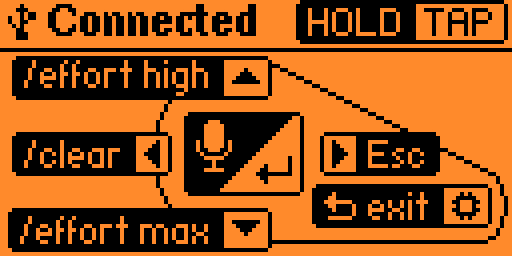
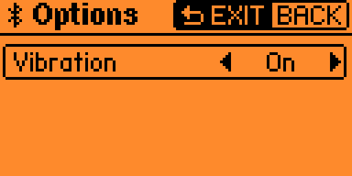

<div align="center">


# F0 Claude Remote

*Your voice runs Claude Code. Your Flipper Zero runs the shortcuts.*

A Flipper Zero app that acts as a Bluetooth remote for Claude Code.

[Documentation](https://petr-korobeinikov.github.io/f0-claude-remote/) ·
[Quick start](https://petr-korobeinikov.github.io/f0-claude-remote/quick-start/) ·
[Debugging](https://petr-korobeinikov.github.io/f0-claude-remote/development/debugging/)

</div>

## LilyGo T-Embed CC1101 (ESP32 port) build

> This fork modifies F0 Claude Remote to run on the
> [Flipper Zero ESP32 port](https://github.com/Sor3nt/Flipper-Zero-ESP32-Port)
> (firmware 2.0.0) on a LilyGo T-Embed CC1101. It is not a build for a stock Flipper Zero.

Changes from upstream:

- The port's app API lacks `furi_event_loop_*`, the power service, the USB HID state
  callback and `icon_get_width`, so `src/platform/esp32_compat.[ch]` adds a small
  polling event loop, battery and USB link state are polled, and icon width is read directly.
- Charging state is not available to apps, so the battery icon never shows charging.
- Exiting no longer crashes the device when the firmware fails to restore its default
  Bluetooth profile.

Controls on the rotary wheel: turn = Up/Down, click = Enter, hold wheel = voice,
hold wheel + quick turn = Left/Right, side key = options, hold side key = exit.
The wheel has no long press for Up/Down/Left/Right, so **Esc, `/clear`, the effort
levels and the hold-Right USB switch are not reachable** on the T-Embed.

Port 2.0.0's Bluetooth only survives one app-started profile per boot: boot with
Bluetooth off in settings, then open the app first.

## Why

Claude Code takes dictation, but a session still asks for the keyboard.
The Flipper's buttons do the rest, so voice and one hand run the whole session.

## Features

- **Dictation:** hold OK and speak; nothing is sent until you tap OK.
- **Prompt:** Enter, the arrows, and Esc to stop a turn.
- **Commands:** hold a button for `/clear` or the effort level.
- **Feedback:** every action buzzes and flashes; a tap on Back opens the options, where the buzz turns off.
- **The dolphin:** a dictation earns it 1 XP, a `/clear` 10.
- **Bluetooth:** a keyboard to the computer, paired once, reconnecting by itself.
- **USB:** with no Bluetooth link, hold Right and the cable takes over.
- **Debugging:** breakpoints on the device from CLion, with no plugin.

## Screens

<table>
<tr>
<td></td>
<td></td>
</tr>
<tr>
<td></td>
<td></td>
</tr>
<tr>
<td></td>
<td></td>
</tr>
<tr>
<td></td>
</tr>
</table>

## Installation

Install it from its
[page](https://lab.flipper.net/apps/f0_claude_remote)
in the Flipper Apps Catalog.

From the source, on a Mac with [mise](https://mise.jdx.dev), the Flipper unlocked on USB:

```shell
mise trust
mise install
mise run setup
mise run launch
```

Then pair it and bind the keys by the
[Quick start](https://petr-korobeinikov.github.io/f0-claude-remote/quick-start/).
Requirements and the other routes are under
[Installation](https://petr-korobeinikov.github.io/f0-claude-remote/guide/installation/).

## Contributing

See [Contributing](https://petr-korobeinikov.github.io/f0-claude-remote/contributing/workflow/).

## License

[GPL-3.0](LICENSE). Copyright (C) 2026 Petr Korobeinikov.
